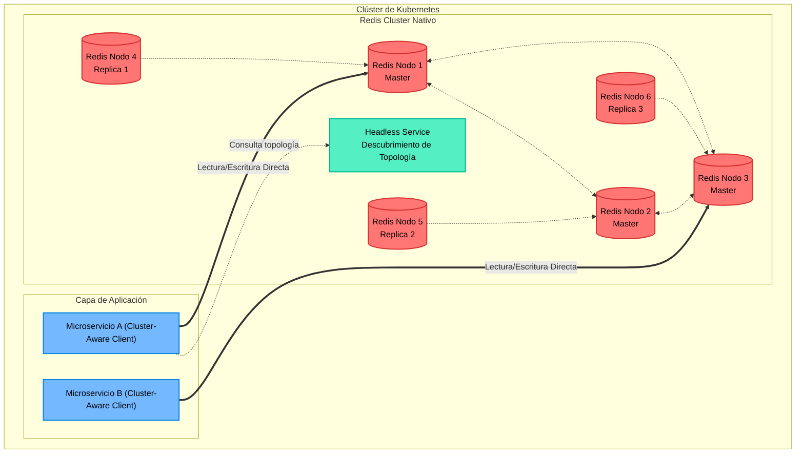
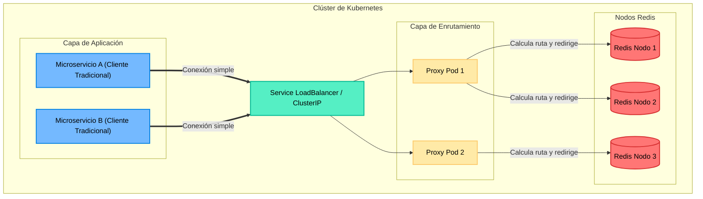

# Análisis de Arquitecturas Redis en Kubernetes

A continuación se presentan los diagramas de flujo y el análisis técnico de los dos enfoques principales para desplegar un clúster de Redis en Kubernetes, así como la evaluación para su uso en un entorno de misión crítica.

## 1. Diagramas de Arquitectura

### Arquitectura A: Redis Cluster Nativo (Clientes Inteligentes)
En este modelo, los microservicios se conectan directamente a los nodos del clúster. El cliente de Redis dentro del código fuente es consciente de la topología y sabe a qué nodo específico enviar la petición basándose en el "Hash Slot" de la llave.

### Arquitectura B: Redis con Proxy (Clientes Tradicionales / "Dumb Clients")
En este modelo, se introduce una capa intermedia (Proxy como Envoy, Twemproxy o Predis). Los microservicios creen que están hablando con un Redis tradicional de un solo nodo. El Proxy intercepta la petición, calcula el Hash Slot y la redirige al nodo correcto.

---

## 2. Ventajas y Desventajas

### A) Redis Cluster Nativo (Sin Proxy)

**Ventajas:**
*   **Mínima Latencia:** No hay saltos de red intermedios. Es el rendimiento más alto posible (fundamental para tiempo real).
*   **Sin cuellos de botella:** Al no haber un Proxy central, el tráfico se distribuye equitativamente entre los nodos.
*   **Alta Disponibilidad Nativa:** El clúster se auto-repara (Failover) de forma automática usando su protocolo *Gossip*.
*   **Menor uso de recursos de infraestructura:** No requieres instanciar, monitorizar ni mantener pods adicionales para la capa Proxy.

**Desventajas:**
*   **Curva de aprendizaje para Desarrollo:** Exige refactorizar el código para usar librerías de cliente de clúster.
*   **Complejidad en el modelo de datos:** Obliga a los desarrolladores a entender e implementar `Hash Tags` (ej. `{emergencia:123}:ubicacion`) para operaciones multi-llave.
*   **Tráfico pesado en red:** Todos los microservicios mantienen conexiones abiertas con *todos* los nodos del clúster (Mesh connection), lo que puede saturar los sockets si hay miles de pods de aplicación.

### B) Redis con Proxy

**Ventajas:**
*   **Cero impacto en Desarrollo:** Los equipos de desarrollo no necesitan tocar ni una línea de código ni cambiar de librerías.
*   **Fácil migración:** Permite pasar de un entorno de desarrollo (Redis Standalone) a producción (Clúster) sin fricción.
*   **Gestión de conexiones:** El proxy actúa como un *Connection Pooler*, reduciendo la cantidad masiva de conexiones hacia los nodos de Redis.

**Desventajas:**
*   **Latencia aumentada:** Cada consulta requiere un salto de red adicional (App -> Proxy -> Redis -> Proxy -> App), lo cual en sistemas críticos se acumula.
*   **Complejidad de Infraestructura:** El Proxy se convierte en un nuevo componente crítico que puede fallar. Debes escalar el Proxy independientemente del clúster de Redis.
*   **Soporte limitado de comandos:** Muchos proxies no soportan el 100% de los comandos de Redis (especialmente pub/sub avanzado, streams o transacciones complejas).

---

## 3. Recomendación para un Sistema C5 Gubernamental

Un sistema **C5 (Centro de Comando, Control, Cómputo, Comunicaciones y Contacto Ciudadano)** es un entorno de **misión crítica Nivel 1**. Maneja despacho de ambulancias, policías, bomberos, telemetría de cámaras de vigilancia y geolocalización en tiempo real. Un segundo de retraso o una caída del sistema puede costar vidas.

**Arquitectura Recomendada:** **Redis Cluster Nativo (Clientes Inteligentes).**

### Justificación Técnica para el C5:

1.  **Ultra-Baja Latencia (Cero intermediarios):**
    En un evento catastrófico (ej. un sismo o un evento de seguridad a gran escala), el sistema recibirá picos masivos de peticiones de lectura/escritura (coordenadas GPS de patrullas, estatus de incidentes). El milisegundo extra que introduce un Proxy se vuelve un problema a escala. La conexión directa del cliente al nodo asegura la respuesta más rápida posible.
2.  **Eliminación de Puntos Únicos de Fallo (SPOF):**
    En el modelo Proxy, la capa de proxies puede convertirse en el cuello de botella bajo estrés extremo de CPU/Red. El Cluster Nativo descentraliza completamente la responsabilidad del enrutamiento hacia los microservicios, haciendo la arquitectura más resiliente.
3.  **Uso de Estructuras de Datos Avanzadas:**
    Los sistemas C5 modernos utilizan fuertemente *Redis Geospatial* (para radios de patrullas), *Redis Streams* (para colas de eventos en tiempo real) y *Pub/Sub*. Muchos Proxies tienen limitaciones o un rendimiento degradado al manejar estas estructuras complejas. El cliente nativo las soporta al 100%.

### Pasos a seguir para tu equipo:
Dado que esta es la recomendación ideal, debes sentarte con el equipo de desarrollo y el de SRE/DevOps para establecer estos lineamientos:
*   **A Desarrollo:** Solicitar la actualización de las librerías a clientes Cluster-Aware y definir una política de nomenclatura de llaves usando **Hash Tags** para agrupar datos de un mismo incidente (ej. `{incidente:911_ABC}:vehiculos`, `{incidente:911_ABC}:estado`).
*   **A Infraestructura:** Evaluar la implementación del clúster nativo utilizando un Operador maduro en Kubernetes (como el *Redis Enterprise Operator* oficial o el *Bitnami Redis Cluster*) que automatice la configuración de la red (Headless Services) y asegure la alta disponibilidad requerida por los estándares gubernamentales.
